# Pruebas del sistema RAG

Este documento registra las pruebas realizadas sobre el sistema RAG, utilizando distintas configuraciones de `chunk_size`, `chunk_overlap` y cantidad de fragmentos recuperados (`k`).

Las pruebas se documentan en el orden en que fueron realizadas:

1. `chunk_size = 300`, `overlap = 80`, `k = 5`.
2. `chunk_size = 300`, `overlap = 80`, `k = 15`.
3. `chunk_size = 1000`, `overlap = 80`, `k = 5`.

Para cada consulta se registra:

- la pregunta realizada;
- la respuesta esperada;
- la respuesta obtenida por el sistema;
- una observación sobre los fragmentos recuperados;
- y, cuando se dispone de ella, la captura de la prueba correspondiente.

La comparación permite observar cómo cambia la recuperación de información al modificar principalmente el valor de `k` y el tamaño de los fragmentos.

---

## 1. Pruebas con `chunk_size = 300`, `overlap = 80`, `k = 5`

### Prueba 1 — Descanso durante la jornada

**Pregunta:**  
> ¿Cuánto tiempo de descanso tienen los trabajadores durante la jornada?

**Respuesta esperada:**  
15 minutos, según CCT 130/75.

**Respuesta obtenida:**

> Los trabajadores tienen un descanso de 2 horas al mediodía, además de un período de descanso anual en proporción de un día de descanso por cada 20 días de trabajo efectivo. También pueden optar por una licencia de 2 horas diarias dentro de la jornada legal de trabajo, y en el caso de suspensión de actividades, deberá mediar una pausa no inferior a 12 horas entre el cese de una jornada y el comienzo de la otra. [1], [2], [3], [4], [5]

**Fragmentos recuperados:**  
Relacionados con la jornada, la carga horaria y el descanso, no acierta.

**Resultado:**  
La respuesta no coincide con la información esperada. Si bien recupera información relacionada con la jornada y los descansos, no recupera el fragmento específico que establece los 15 minutos correspondientes a la pregunta.

---

### Prueba 2 — Tiempo para tomar un refrigerio

**Pregunta:**  
> ¿Cuánto tiempo tienen por jornada los trabajadores para tomar un refrigerio?

**Respuesta esperada:**  
15 minutos, según CCT 130/75.

**Respuesta obtenida:**

> Los trabajadores tendrán derecho a tomar un refrigerio durante la jornada de trabajo, con un período de 15 minutos diarios en forma rotativa por la tarde. [1]

**Fragmentos recuperados:**  
Relacionados con la jornada, la carga horaria y el descanso, además del fragmento específico recuperado.

**Resultado:**  
La respuesta coincide con lo esperado y, en este caso, el sistema recupera el fragmento específico que contiene la información solicitada.

**Captura de la prueba:**

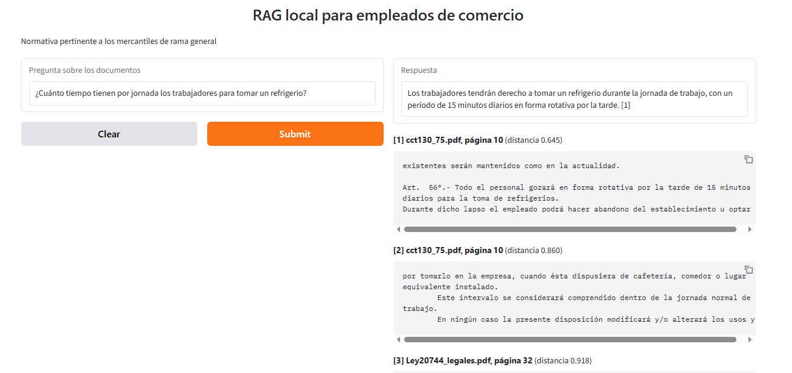

---

### Prueba 3 — Día del Empleado de Comercio

**Pregunta:**  
> ¿Qué día es el Día del Empleado de Comercio?

**Respuesta esperada:**  
Es el 26 de septiembre, día de descanso para empleados de comercio, que se asimila a los feriados nacionales a todos los efectos legales.

**Respuesta obtenida:**

> El Día del Empleado de Comercio se instituye el 26 de septiembre de cada año. [1]

**Fragmentos recuperados:**  
Uno preciso y suficiente, cuatro no relacionados.

**Resultado:**  
La respuesta coincide con la fecha esperada. El sistema recupera un fragmento preciso y suficiente, aunque los demás fragmentos recuperados no están relacionados con la consulta.

**Nota:**  
No se incluyó una captura de pantalla de esta prueba en el material proporcionado.

---

### Prueba 4 — Definición del contrato de trabajo

**Pregunta:**  
> ¿Cómo define el contrato de trabajo el artículo 21 de la LCT?

**Respuesta esperada:**  
Prestación de actos, obras o servicios bajo dependencia y mediante remuneración, según el texto del art. 21 de la Ley 20.744.

**Respuesta obtenida:**

> El artículo 21 de la Ley de Contrato de Trabajo (LCT) define que un contrato de trabajo existe siempre que una persona física se obligue a realizar actos, ejecutar obras o prestar servicio en favor de otra, bajo la dependencia de ésta, en forma voluntaria y mediante el pago de una remuneración, cualquiera sea el acto que le dé origen. [1], [3]

**Fragmentos recuperados:**  
Relacionados a la relación laboral, y acierta en recuperar el fragmento exacto que se solicitó.

**Resultado:**  
La respuesta coincide con lo esperado y el sistema recupera el fragmento exacto correspondiente al artículo consultado.

**Captura de la prueba:**

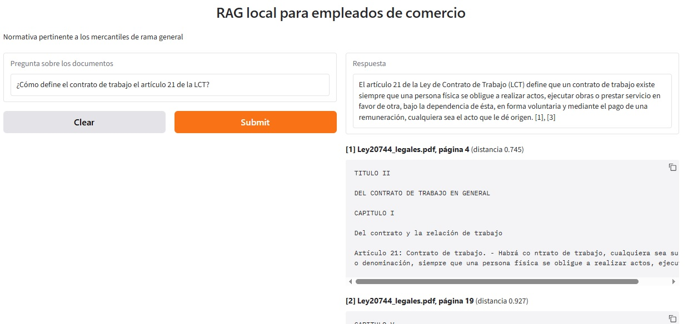

---

### Prueba 5 — Derechos sindicales

**Pregunta:**  
> ¿Qué derechos sindicales enumera el artículo 4 de la Ley 23551?

**Respuesta esperada:**  
Entre otros, constituir asociaciones, afiliarse o desafiliarse, reunirse, desarrollar actividades sindicales y elegir representantes.

**Respuesta obtenida:**

> El artículo 4 de la Ley 23551 enumera que los trabajadores tienen los siguientes derechos sindicales: a) Constituir libremente y sin necesidad de autorización previa, asociaciones sindicales; b) Afiliarse a las ya constituidas, no afiliarse o desafiliarse. [1], [2], [3]

**Resultado:**  
La respuesta recupera parte de los derechos enumerados en el artículo 4. En particular, identifica correctamente los derechos de constituir asociaciones y afiliarse, no afiliarse o desafiliarse, aunque no enumera todos los derechos indicados en la respuesta esperada.

**Captura de la prueba:**

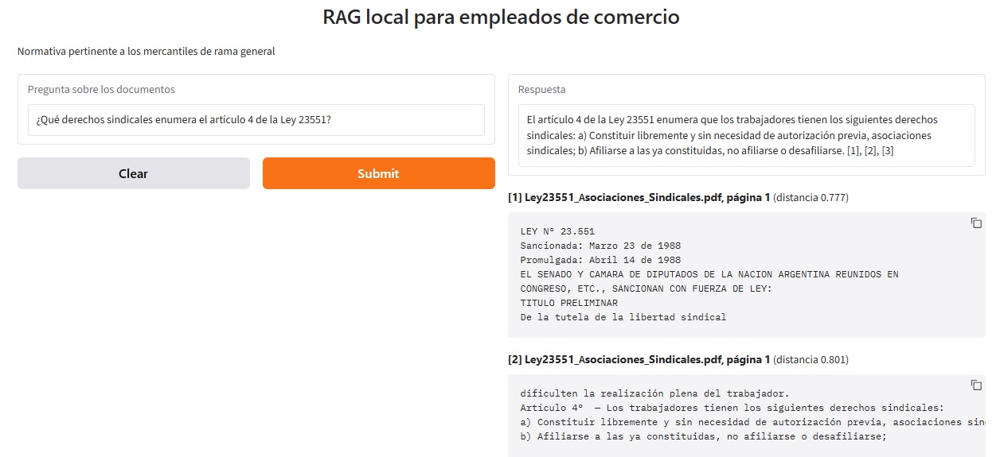

---

### Prueba 6 — Pregunta sin respuesta en el corpus

**Pregunta:**  
> ¿Cuál fue la facturación anual de supermercados Coto en 2025?

**Respuesta esperada:**  
> "No encuentro esa información en los documentos."

**Respuesta obtenida:**

> "No encuentro esa información en los documentos."

**Resultado:**  
El sistema se abstiene de responder y reconoce que la información solicitada no se encuentra en los documentos.

**Captura de la prueba:**

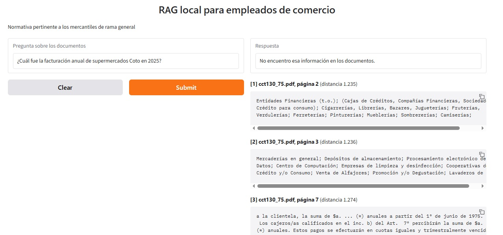

---

### Prueba 7 — Pregunta sin respuesta en el corpus

**Pregunta:**  
> ¿Cuál es el horario de apertura de la sede central del sindicato?

**Respuesta esperada:**  
> "No encuentro esa información en los documentos."

**Respuesta obtenida:**

> "No encuentro esa información en los documentos."

**Resultado:**  
El sistema se abstiene de responder y reconoce que la información solicitada no se encuentra en los documentos.

**Captura de la prueba:**

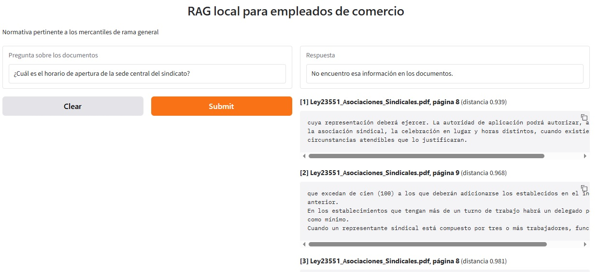

---

## 2. Pruebas con `chunk_size = 300`, `overlap = 80`, `k = 15`

En esta segunda configuración se mantiene el mismo tamaño de fragmento y solapamiento, pero se aumenta `k` de 5 a 15. De esta manera, el sistema puede incorporar una mayor cantidad de fragmentos recuperados para responder cada consulta.

### Prueba 1 — Descanso durante la jornada

**Pregunta:**  
> ¿Cuánto tiempo de descanso tienen los trabajadores durante la jornada?

**Respuesta esperada:**  
15 minutos, según CCT 130/75.

**Respuesta obtenida:**

> Los trabajadores tienen derecho a un descanso de 2 horas al mediodía si trabajan en horas de la mañana y de la tarde [1]. Además, entre el cese de una jornada y el comienzo de la otra deberá mediar una pausa no inferior a 12 horas [4]. También, los trabajadores tendrán derecho a percibir la remuneración indicada siempre que hubiesen trabajado a las órdenes de un mismo empleador 48 horas o 6 jornadas consecutivas [13].

**Fragmentos recuperados:**  
Relacionados con la jornada, la carga horaria y el descanso, no acierta.

**Resultado:**  
El aumento de `k` no permite recuperar el fragmento que contiene la respuesta esperada. Se recuperan varios fragmentos relacionados con jornada y descanso, pero la respuesta generada no identifica los 15 minutos buscados.

**Captura de la prueba:**

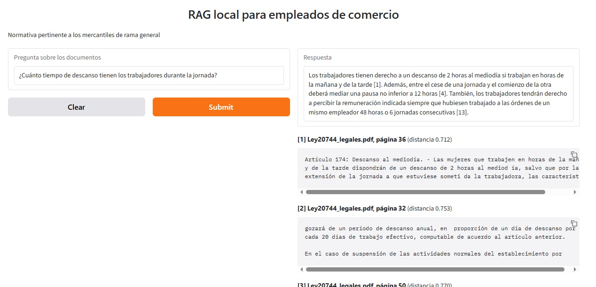

---

### Prueba 2 — Tiempo para tomar un refrigerio

**Pregunta:**  
> ¿Cuánto tiempo tienen por jornada los trabajadores para tomar un refrigerio?

**Respuesta esperada:**  
15 minutos, según CCT 130/75.

**Respuesta obtenida:**

> Los trabajadores tendrán un período de descanso diario de 15 minutos para tomar refrigerios. [1]

**Fragmentos recuperados:**  
Relacionados con la jornada, la carga horaria y el descanso, además del fragmento específico recuperado.

**Resultado:**  
La respuesta coincide con lo esperado y el sistema recupera el fragmento específico correspondiente a la consulta.

**Captura de la prueba:**

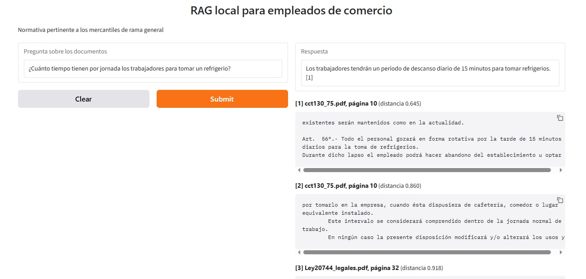

---

### Prueba 6 — Pregunta sin respuesta en el corpus

**Pregunta:**  
> ¿Cuál fue la facturación anual de supermercados Coto en 2025?

**Respuesta esperada:**  
> "No encuentro esa información en los documentos."

**Respuesta obtenida:**

> "No encuentro esa información en los documentos."

**Resultado:**  
El sistema mantiene la abstención ante una pregunta cuya información no figura en el corpus.

**Captura de la prueba:**

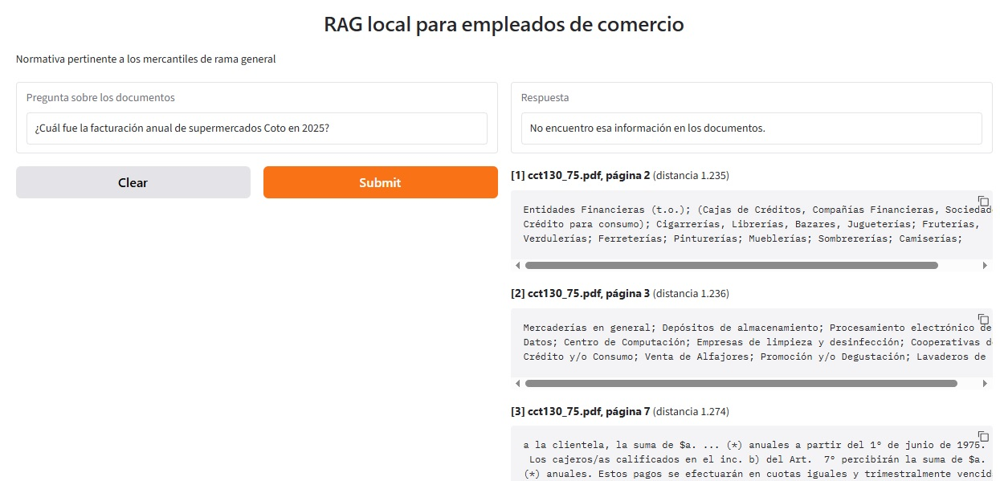

---

### Prueba 7 — Pregunta sin respuesta en el corpus

**Pregunta:**  
> ¿Cuál es el horario de apertura de la sede central del sindicato?

**Respuesta esperada:**  
> "No encuentro esa información en los documentos."

**Respuesta obtenida:**

> "No encuentro esa información en los documentos."

**Resultado:**  
El sistema mantiene la abstención y no inventa un horario que no se encuentra en los documentos.

**Captura de la prueba:**

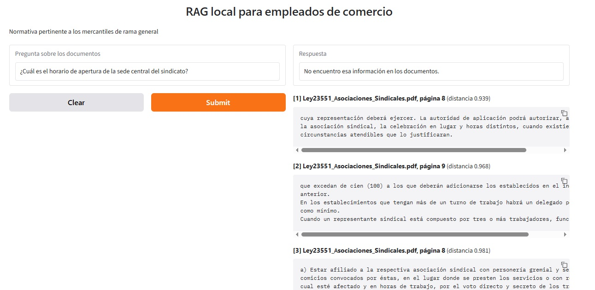

---

## 3. Pruebas con `chunk_size = 1000`, `overlap = 80`, `k = 5`

En la tercera configuración se vuelve a utilizar `k = 5`, pero se aumenta el tamaño de los fragmentos de 300 a 1000. El objetivo de esta prueba es observar el comportamiento de la recuperación utilizando fragmentos más grandes.

### Prueba 1 — Descanso durante la jornada

**Pregunta:**  
> ¿Cuánto tiempo de descanso tienen los trabajadores durante la jornada?

**Respuesta esperada:**  
15 minutos, según CCT 130/75.

**Respuesta obtenida:**

> Los trabajadores tienen derecho a un descanso anual proporcional, con un día de descanso por cada 20 días de trabajo efectivo, según lo establece el artículo 153 de la Ley 20.744. Además, se goza de un descanso semanal prohibición de trabajar de las 13 horas del día sábado hasta las 24 horas del día siguiente, salvo excepciones previstas en el artículo, en cuyo caso se debe ofrecer un descanso compensatorio de la misma duración. [1], [2], [3], [4], [5]

**Fragmentos recuperados:**  
Relacionados con la jornada, la carga horaria y el descanso, no acierta.

**Resultado:**  
Con fragmentos de mayor tamaño tampoco se recupera la información específica esperada. Los fragmentos contienen información relacionada con distintos tipos de descanso, pero la respuesta no identifica el período de 15 minutos de la pregunta.

**Captura de la prueba:**

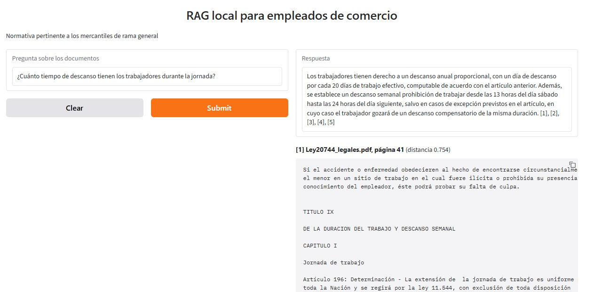

---

### Prueba 6 — Pregunta sin respuesta en el corpus

**Pregunta:**  
> ¿Cuál fue la facturación anual de supermercados Coto en 2025?

**Respuesta esperada:**  
> "No encuentro esa información en los documentos."

**Respuesta obtenida:**

> "No encuentro esa información en los documentos."

**Resultado:**  
El sistema mantiene la abstención frente a una consulta cuya información no está presente en el corpus.

**Captura de la prueba:**

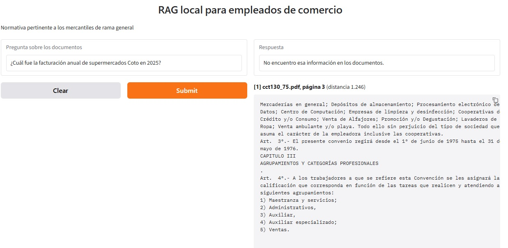

---

## 4. Comparación de las configuraciones

Las pruebas permiten observar tres configuraciones diferentes:

| Configuración | Preguntas probadas | Observación principal |
|---|---|---|
| `chunk_size=300`, `overlap=80`, `k=5` | 1, 2, 3, 4, 5, 6 y 7 | Responde correctamente algunas consultas y recupera fragmentos específicos en las pruebas 2 y 4. También logra abstenerse ante las preguntas 6 y 7. En la pregunta 1 recupera información relacionada, pero no la respuesta esperada. |
| `chunk_size=300`, `overlap=80`, `k=15` | 1, 2, 6 y 7 | Aumentar `k` permite recuperar más fragmentos, pero en la pregunta 1 siguen apareciendo fragmentos relacionados con jornada y descanso sin encontrar la respuesta esperada. La pregunta 2 continúa recuperando el fragmento específico y las preguntas sin respuesta mantienen la abstención. |
| `chunk_size=1000`, `overlap=80`, `k=5` | 1 y 6 | El aumento del tamaño de los fragmentos no permite resolver la pregunta 1. En la pregunta 6 el sistema continúa identificando correctamente que la información no está en los documentos. |

### Limitación observada

Una de las limitaciones más claras aparece en la pregunta:

> ¿Cuánto tiempo de descanso tienen los trabajadores durante la jornada?

La respuesta esperada era **15 minutos**, pero las distintas configuraciones probadas recuperan información relacionada con otros tipos de descanso, como el descanso al mediodía, el descanso entre jornadas o el descanso anual.

Esto muestra que recuperar fragmentos relacionados con las palabras de una consulta no garantiza que se haya recuperado la evidencia necesaria para responderla correctamente. En este caso, modificar `k` o aumentar `chunk_size` no solucionó el problema.

Por otro lado, las preguntas cuya información no estaba presente en los documentos fueron respondidas con:

> "No encuentro esa información en los documentos."

Esto permite comprobar el comportamiento del sistema ante consultas que no pueden ser respondidas a partir del corpus utilizado, de forma que no se da por sentada la abstención.

---

## 5. Conclusión de las pruebas

Las pruebas muestran el comportamiento del RAG frente a distintas combinaciones de tamaño de fragmento y cantidad de resultados recuperados.

El cambio de `k=5` a `k=15` aumenta la cantidad de fragmentos recuperados, pero no necesariamente mejora la respuesta: en la pregunta sobre el descanso durante la jornada se incorporan más fragmentos relacionados, pero continúa sin recuperarse la evidencia correcta.

De manera similar, utilizar `chunk_size=1000` en lugar de `chunk_size=300` no permite resolver esa consulta problemática.

En cambio, otras consultas sí muestran una recuperación precisa, como la correspondiente al tiempo de refrigerio y la definición del contrato de trabajo. Además, las preguntas cuya información no se encuentra en el corpus permiten comprobar que el sistema puede reconocer la ausencia de información y abstenerse de inventar una respuesta.

Estas pruebas sirven para documentar tanto los aciertos como las limitaciones del sistema, tal como requiere la evaluación del proyecto.

Queda por ver si, dada la naturaleza del corpus, conformado por paquetes de artículos de legislación, cuyo sentido muchas veces se completa de acuerdo con el capítulo al que pertenece el artículo en cuestión, mayores tamaños de chunks podrían acercarnos a mejores respuestas. Debido a limitaciones de hardware, estas pruebas no fueron posibles.
